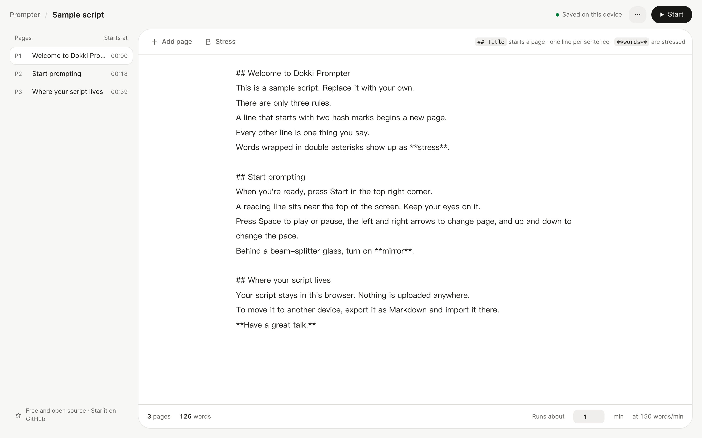
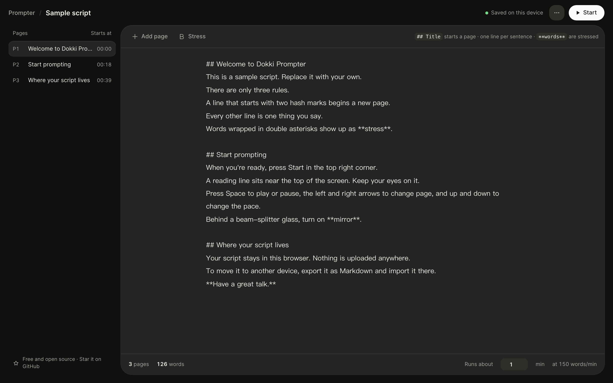
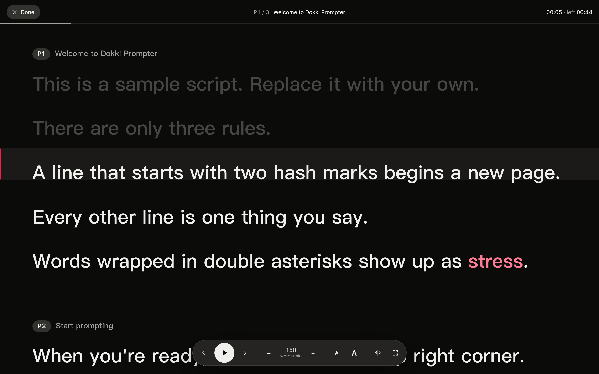
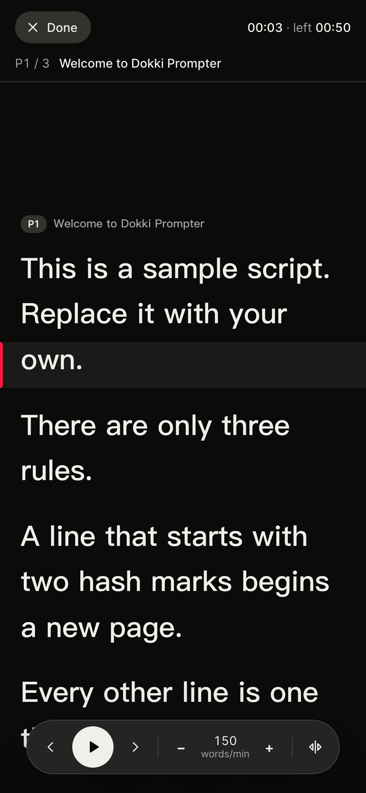

<p align="center">
  
</p>

<h1 align="center">Dokki Prompter</h1>

<p align="center">
  <b>A teleprompter that reads at the speed you speak.</b><br>
  Write your script, press Start, keep your eyes on one line.<br>
  Free, open source, and your script never leaves your browser.
</p>

<p align="center">
  <a href="https://dokki-prompter.vercel.app"><b>Try it live</b></a> ·
  <a href="README.zh-CN.md">简体中文</a> ·
  <a href="#deploy-your-own">Deploy your own</a>
</p>

<p align="center">
  <a href="LICENSE"></a>
  <a href="https://github.com/Noxr3/dokki-prompter/actions/workflows/ci.yml"></a>
  
  
  <a href="https://github.com/Noxr3/dokki-prompter/stargazers"></a>
</p>

<p align="center">
  
</p>

## Why another teleprompter?

Most web prompters scroll at a fixed number of pixels per second. Change the font size or hit a long sentence, and the pace you rehearsed no longer matches the pace you speak.

Dokki Prompter paces the script in **words per minute** (characters per minute for Chinese, Japanese and Korean). Every line stays on the reading line in proportion to what's in it, so a short line and a long line pass at the same speaking pace, at any text size. Tell it how many minutes your talk should run and it works out the pace for you.

## Features

- **Three rules to write a script.** `## Title` starts a page, every other line is one thing you say, and `**words**` are stressed.
- **Paced like speech.** Set the pace in words or characters per minute, or type the length of the talk and the pace follows. The outline shows when each page starts.
- **A stage built for reading.** One reading line, dimmed past lines, highlighted stress, page jumps, pace and text-size controls, a timer and time left.
- **Ready for real rigs.** Mirror mode for beam-splitter glass, full screen, and the screen stays awake while it plays.
- **Private by design.** No server, no account, no analytics, no third-party requests. The script saves to your device; import and export Markdown, or drop a `.md` file on the page.
- **Fits anywhere.** Light and dark themes, phones and tablets, and an interface in English and Simplified Chinese.
- **Tiny.** Plain HTML, CSS and JavaScript modules. No framework, no dependencies, no build step.

<table>
  <tr>
    <td width="50%"></td>
    <td width="50%"></td>
  </tr>
  <tr>
    <td width="50%"></td>
    <td width="50%" align="center"></td>
  </tr>
</table>

## Write a script

```markdown
# Product launch               ← optional: the script's name
## Opening                     ← starts a new page
Good morning, everyone.        ← one line is one thing you say
Today I want to show you **one simple idea**.   ← stressed words
```

Page titles are cues for you and are not counted as speech. Lines before the first `##` become an opening page. A `P3 ·` prefix on a heading is dropped, because pages are numbered for you.

## Keyboard

| Where | Keys | Does |
|---|---|---|
| Editor | <kbd>⌘</kbd>/<kbd>Ctrl</kbd> + <kbd>Enter</kbd> | Start from the page your cursor is on |
| Editor | <kbd>⌘</kbd>/<kbd>Ctrl</kbd> + <kbd>S</kbd> | Save to this device now |
| Stage | <kbd>Space</kbd> | Play / pause |
| Stage | <kbd>←</kbd> <kbd>→</kbd> | Previous / next page |
| Stage | <kbd>↑</kbd> <kbd>↓</kbd> | Pace ±10 |
| Stage | <kbd>+</kbd> <kbd>−</kbd> | Text size |
| Stage | <kbd>M</kbd> / <kbd>F</kbd> | Mirror / full screen |
| Stage | <kbd>Esc</kbd> | Back to editing |

## Deploy your own

[](https://vercel.com/new/clone?repository-url=https%3A%2F%2Fgithub.com%2FNoxr3%2Fdokki-prompter&project-name=dokki-prompter&repository-name=dokki-prompter)

It's a static site: everything served is in [`public/`](public).

- **Vercel**: use the button above, or import the repository. There is nothing to configure; [`vercel.json`](vercel.json) sets the output directory and security headers.
- **Anywhere else** (GitHub Pages, Cloudflare Pages, Netlify, an Nginx box): publish the `public/` directory.

## Develop

Requires Node.js 20 or newer, and nothing else.

```bash
git clone https://github.com/Noxr3/dokki-prompter.git
cd dokki-prompter
npm run dev     # http://localhost:5173
npm test        # script format and timing tests
```

```
public/
  index.html
  src/format.js   script parsing, word counts and timing (pure, tested)
  src/stage.js    the prompting stage: reading line, scrolling, keys
  src/app.js      editor, saving, import and export
  src/i18n.js     interface text and the sample scripts
  src/styles.css  design tokens from Dokki Fusion
tests/            node:test unit tests
scripts/serve.js  a zero-dependency dev server
```

## Roadmap

Ideas we'd like help with. Pick one, or [open an issue](https://github.com/Noxr3/dokki-prompter/issues/new/choose) with your own.

- Voice follow: scroll by listening to the speaker
- Share a script as a link, with no server involved
- A library of several scripts
- A countdown before playback starts
- Remote control from a phone
- Offline install as a PWA

## Contributing

Issues and pull requests are welcome. Read [CONTRIBUTING.md](CONTRIBUTING.md) first; the short version is to stay dependency-free, run `npm test`, and check the editor and the stage at phone width.

## About

Made by [Brad](https://github.com/Noxr3), founder of [Dokki](https://dokki.one), an operating system where people and AI agents work together. The prompter started as the tool we used to rehearse our own pitch, and it uses Dokki's Fusion design language.

If it helps you give a better talk, a ⭐ helps other people find it.

[](https://star-history.com/#Noxr3/dokki-prompter&Date)

## License

[Apache License 2.0](LICENSE)
