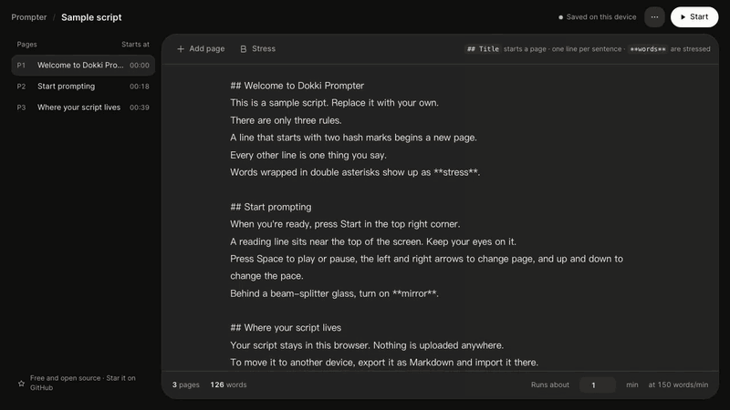
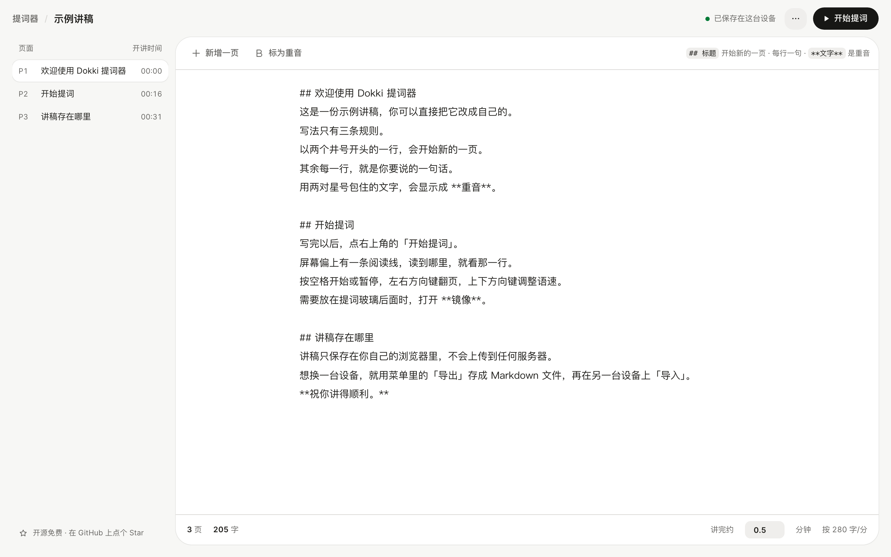
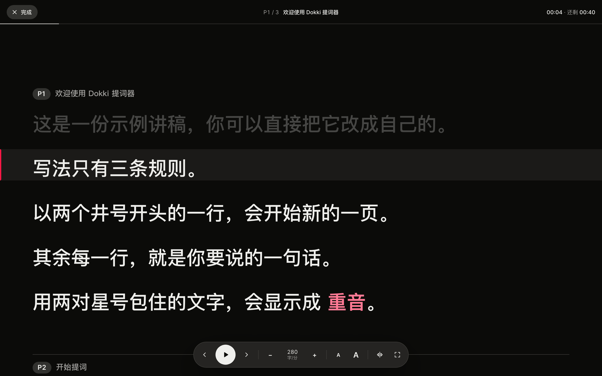

<p align="center">
  
</p>

<h1 align="center">在线提词器 Online Teleprompter</h1>

<p align="center">
  <b>按你说话速度滚动的免费在线提词器。</b><br>
  写好讲稿，点「开始提词」，眼睛只看一条阅读线。<br>
  免费、开源，讲稿永远不离开你的浏览器。
</p>

<p align="center">
  <a href="https://free-teleprompter.vercel.app/zh/"><b>在线试用</b></a> ·
  <a href="README.md">English</a> ·
  <a href="https://free-teleprompter.vercel.app/zh/guide">使用指南</a> ·
  <a href="#部署自己的版本">部署自己的版本</a>
</p>

<p align="center">
  
</p>

## 为什么再做一个提词器？

大多数网页提词器按固定的「像素/秒」滚动。字号一变，或者遇到一句长句，排练时的节奏就和实际说话对不上了。

在线提词器按 **字/分**（英文按 **词/分**）控制节奏：每一行在阅读线上停留多久，取决于这一行有多少字。所以无论字号多大，长句和短句都按同样的语速走。你也可以直接告诉它「这场要讲几分钟」，语速会自动算好。

## 功能

- **写法只有三条**：`## 标题` 开始新的一页；其余每一行是一句话；`**文字**` 是重音。
- **按讲话速度滚动**：用字/分设置语速，或者填「讲完约 N 分钟」倒推语速；左侧大纲标出每页的开讲时间。
- **为朗读设计的提词模式**：一条阅读线、读过的行变暗、重音高亮、翻页、调语速、调字号、计时和剩余时间。
- **能上真设备**：镜像模式适配提词玻璃，全屏，播放时屏幕常亮。
- **私密**：没有服务器、没有账号、没有统计，也不请求任何第三方资源。讲稿保存在本机，可导入 / 导出 Markdown，或者直接把 `.md` 文件拖进页面。
- **到处能用**：浅色 / 深色，手机和平板，界面有简体中文和英文。
- **很小**：纯 HTML、CSS 和 JavaScript 模块，没有框架、没有依赖、没有构建步骤。

<table>
  <tr>
    <td width="50%"></td>
    <td width="50%"></td>
  </tr>
</table>

## 讲稿怎么写

```markdown
# 产品发布会                   ← 可选：讲稿名称
## 开场                        ← 开始新的一页
大家早上好。                    ← 每一行是一句话
今天我想分享 **一个简单的想法**。  ← 重音
```

页标题只是给你看的提示，不计入讲话时长。第一个 `##` 之前的内容会成为「开场」页。标题前的 `P3 ·` 这类编号会自动去掉，页码由提词器生成。

## 快捷键

| 场景 | 按键 | 作用 |
|---|---|---|
| 编辑 | <kbd>⌘</kbd>/<kbd>Ctrl</kbd> + <kbd>Enter</kbd> | 从光标所在的页开始提词 |
| 编辑 | <kbd>⌘</kbd>/<kbd>Ctrl</kbd> + <kbd>S</kbd> | 立即保存到本机 |
| 提词 | <kbd>空格</kbd> | 开始 / 暂停 |
| 提词 | <kbd>←</kbd> <kbd>→</kbd> | 上一页 / 下一页 |
| 提词 | <kbd>↑</kbd> <kbd>↓</kbd> | 语速 ±10 |
| 提词 | <kbd>+</kbd> <kbd>−</kbd> | 字号 |
| 提词 | <kbd>M</kbd> / <kbd>F</kbd> | 镜像 / 全屏 |
| 提词 | <kbd>Esc</kbd> | 回到编辑 |

## 部署自己的版本

[](https://vercel.com/new/clone?repository-url=https%3A%2F%2Fgithub.com%2FNoxr3%2Fonline-teleprompter&project-name=online-teleprompter&repository-name=online-teleprompter)

这是一个纯静态网站，所有内容都在 [`public/`](public) 目录里。

- **Vercel**：点上面的按钮，或者在 Vercel 里导入这个仓库，不用改任何设置。
- **其他任意静态托管**（GitHub Pages、Cloudflare Pages、Netlify、Nginx）：发布 `public/` 目录即可。

## 本地开发

只需要 Node.js 20 或更新版本。

```bash
git clone https://github.com/Noxr3/online-teleprompter.git
cd online-teleprompter
npm run dev     # http://localhost:5173
npm test        # 讲稿格式与计时的单元测试
```

## 路线图

欢迎认领，或者[提一个新想法](https://github.com/Noxr3/online-teleprompter/issues/new/choose)。

- 跟读：听着讲话自动滚动
- 不经过服务器，用一个链接分享讲稿
- 保存多份讲稿
- 开始前倒计时
- 用手机遥控
- 作为 PWA 离线安装

## 参与贡献

欢迎 Issue 和 Pull Request。请先看 [CONTRIBUTING.md](CONTRIBUTING.md)：不引入依赖，跑通 `npm test`，并在手机宽度下检查编辑和提词两个界面。

## 关于

由 [Brad](https://github.com/Noxr3) 制作。他也是 [Dokki](https://dokki.one) 的创始人，Dokki 是一个让人和 AI Agent 一起工作的操作系统。这个提词器最早是我们排练自己路演时用的工具，界面沿用 Dokki 的 Fusion 设计语言。

如果它帮你讲得更好，点个 ⭐ 能让更多人找到它。

## 许可证

[Apache License 2.0](LICENSE)
